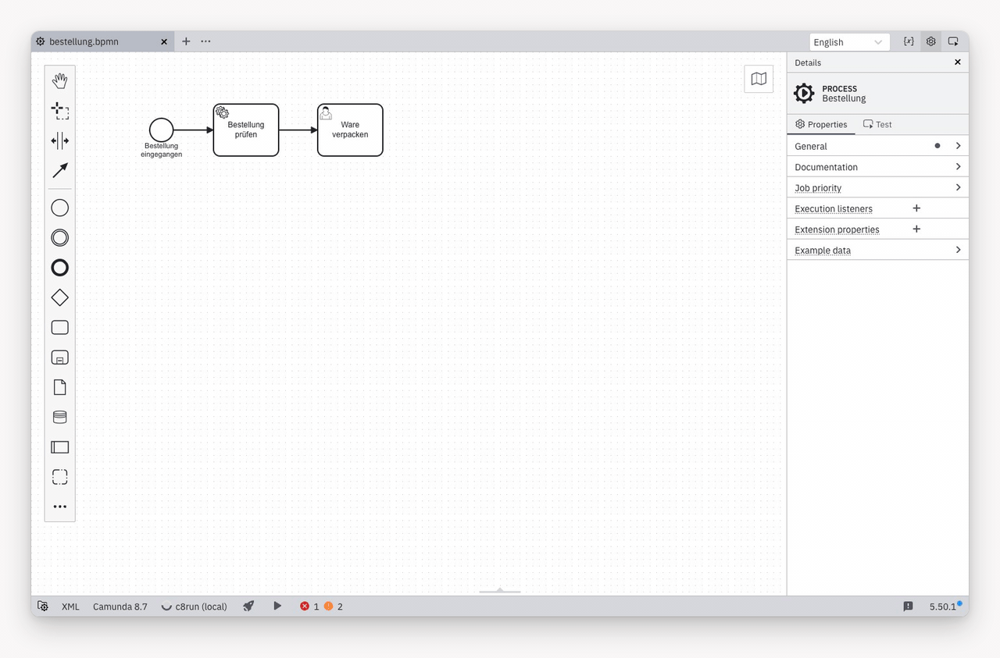

# Camunda Modeler i18n Plugin

**Model BPMN and DMN in the Camunda Modeler in your own language.**

A plugin by Miragon for the Camunda Modeler desktop app that adds a language dropdown to the toolbar and translates the editors into 11 languages besides English.

## Why

The Camunda Modeler's editors only speak English, so a team that thinks in another language translates every label in their heads.

## What you get

- **Every editor panel.** The tool palette, the menu next to a selected element and the properties panel of the BPMN and DMN editors show translated labels.
- **Camunda 7 and Camunda 8.** The properties of both engines are translated.
- **Your choice remembered.** The Modeler keeps the language you picked across restarts, per user.

Camunda Forms, the lint messages and the Modeler's own menus and dialogs are not translated yet.

## Supported languages

| In the dropdown          | Language            |
| ------------------------ | ------------------- |
| Deutsch                  | German              |
| English                  | English             |
| Español                  | Spanish             |
| Français                 | French              |
| Italiano                 | Italian             |
| Português (Brasil)       | Portuguese (Brazil) |
| 简体中文                 | Simplified Chinese  |
| 繁体中文                 | Traditional Chinese |
| Русский                  | Russian             |
| Nederlands (Netherlands) | Dutch               |
| 日本語                   | Japanese            |
| 한국어                   | Korean              |

Some strings stay English; the [coverage report](apps/camunda-modeler-i18n-plugin/docs/COVERAGE.md) shows how complete each language is. Missing your language? [Ask for it in an issue](https://github.com/Miragon/camunda-modeler-i18n-plugin/issues).

## Install

The plugin is tested with Camunda Modeler 5.50.1. Your plugins folder depends on your operating system:

| Operating system | Plugins folder                                                    |
| ---------------- | ----------------------------------------------------------------- |
| Windows          | `%APPDATA%\camunda-modeler\resources\plugins`                     |
| macOS            | `~/Library/Application Support/camunda-modeler/resources/plugins` |
| Linux            | `~/.config/camunda-modeler/resources/plugins`                     |

1. Download `plugin-v<version>.zip` under **Assets** of the newest [plugin release](https://github.com/Miragon/camunda-modeler-i18n-plugin/releases?q=plugin-v&expanded=true).
2. Create a folder named `i18n` in the plugins folder for your system, and the `resources/plugins` folders above it if they are missing.
3. Unzip the download into it, so that `index.js` and `dist/` sit directly in `i18n`, not in a subfolder.

To install for everyone on a machine, see Camunda's [search paths](https://docs.camunda.io/docs/components/modeler/desktop-modeler/search-paths/).

## Get started

1. Start the Camunda Modeler, or quit and reopen it if it was running, and open a BPMN or DMN diagram.
2. Pick your language in the toolbar dropdown.
3. Save your work and restart the Modeler, as the dialog asks.

## Help and feedback

- **Wrong or missing translation:** [open an issue](https://github.com/Miragon/camunda-modeler-i18n-plugin/issues) with the language and the exact English text.
- **Plugin does not show up:** compare your folder with the [plugin README](apps/camunda-modeler-i18n-plugin/README.md#installation), then open an issue.
- **Questions and professional support:** write to [info@miragon.io](mailto:info@miragon.io).
- **Modelling in VS Code or the browser:** the [Miragon BPMN Modeler](https://miragon.github.io/bpmn-modeler/) uses these translations too.
- **Your own bpmn-js app:** use the npm package [`@miragon/bpmn-modeler-i18n`](packages/translations/README.md).

## Contributing

We do not accept outside pull requests right now; suggest translation fixes in an issue instead. How to build and test the plugin is in [CONTRIBUTING.md](CONTRIBUTING.md).

## License

[MIT](LICENSE) © Miragon GmbH
